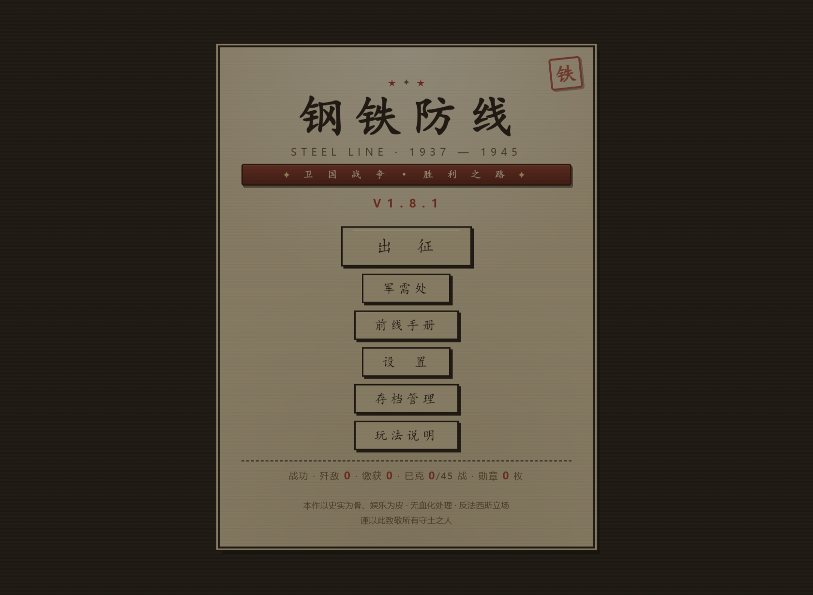
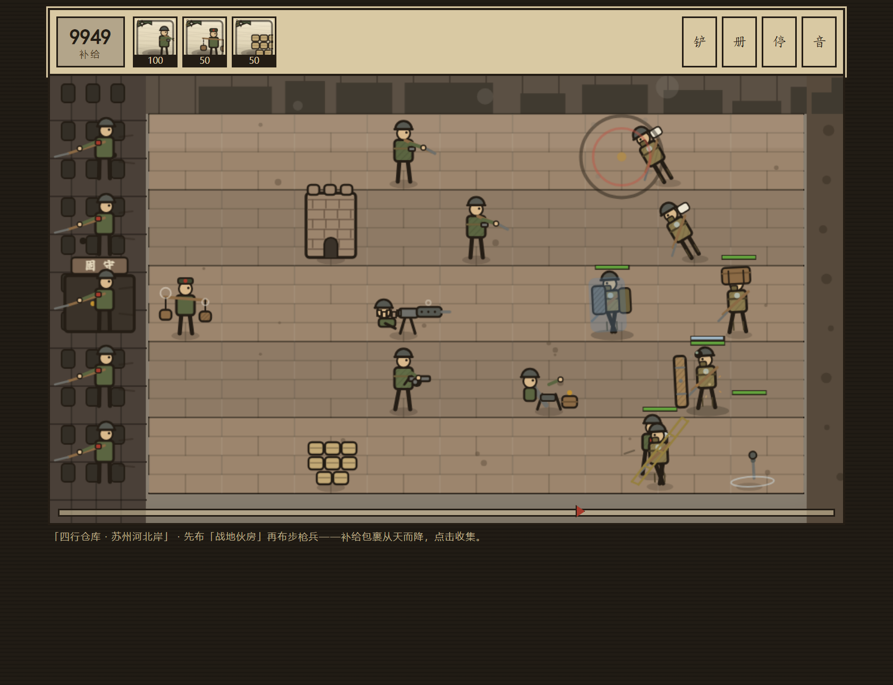
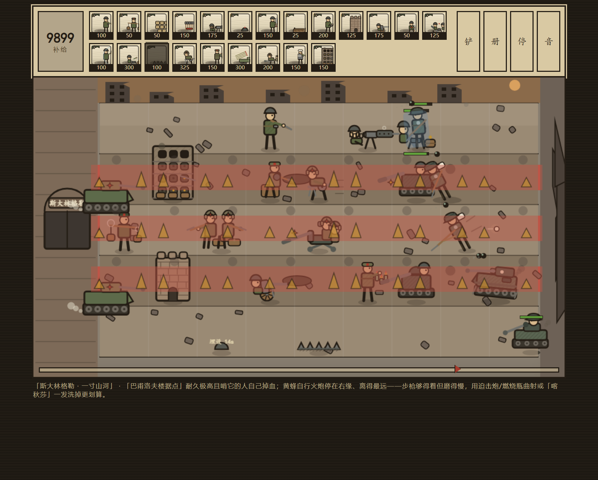
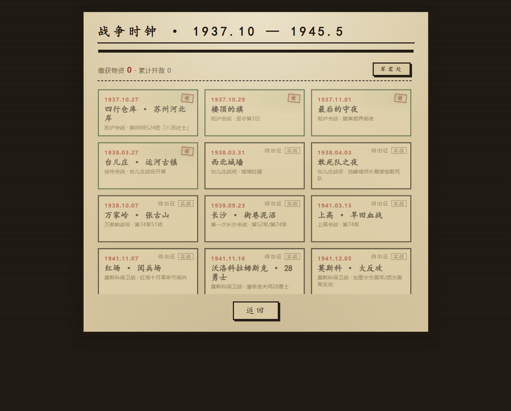

# 钢铁防线 STEEL LINE 1937–1945

**纯前端 Canvas 塔防 · 45 关 · 零依赖零构建 · 双击即玩**



> 本作以史实为骨、娱乐为皮 · 无血化处理 · 反法西斯立场
> 谨以此致敬所有守土之人。

| | |
|---|---|
| 🎮 在线试玩 | https://yuyue-2011.github.io/steel-line-1937/ |
| ⬇️ 单文件下载 | [Releases · v1.8.1](https://github.com/yuyue-2011/steel-line-1937/releases/tag/v1.8.1)（304 KB，离线可玩） |
| 📋 设计与测试记录 | [半归档清单.md](半归档清单.md) |

---

## 这是什么

一款用原生 JavaScript + Canvas 手写渲染的**二维阵地防守游戏**：你守一段防线，靠补给部署兵种卡，顶住一波波步兵、装甲与工兵，直到扛旗的总攻波被打退。

没有框架、没有构建步骤、没有一张外部图片——所有地形、单位、特效都是代码画出来的矢量像素图，音效由 WebAudio 实时合成。整个游戏就是一个可以双击打开的网页。

## 玩法速览

1. **收补给** —— 点击从天而降的补给包裹，数值显示在左上角；「战地伙房」能自产。
2. **布阵地** —— 点选下方兵种卡，再点格子部署，每张卡有独立冷却；数字键 `1-9/0` 快速选卡。
3. **看血条** —— 敌军头顶常显血条（门板盾为蓝白细条），己方单位受损后也会显示。
4. **三档难度** —— 每关战报可自选 练兵 / 实战 / 精锐（精锐首克授纪念章）。
5. **反冲击** —— 敌军突入左端时，该行待命的「反冲击小队」自动清行，但一行只有一次。
6. **工兵铲** —— 拆除己方部署（不返还补给），也能掀掉敌军搭上的竹梯。

几条不是一眼能看出来的规矩：

- 水道要先铺「门桥浮台」才能布兵；「黑海水兵班」可直接下水。
- 高跷兵蹦得过沙袋，蹦不过「城墙碉垒」；掘进工兵钻地绕后会**从左往右拆家**；装甲推土车只有反坦克地刺治得了。
- 门板盾兵正面免疫直射，怕曲射（迫击炮/手榴弹）与近战；泅渡兵潜行时打不着。
- 扛旗敌兵出现即「大规模进攻！」——那是最后一波。

## 快速开始

**① 在线玩**：打开 https://yuyue-2011.github.io/steel-line-1937/

**② 单文件离线版**：到 [Releases](https://github.com/yuyue-2011/steel-line-1937/releases/tag/v1.8.1) 下载 `V1.8.1.html`，双击即可，无需联网、无需同目录资源。

**③ 源码运行**：克隆或下载本仓库，直接用浏览器打开 `index.html`（推荐桌面 Chrome / Edge / Firefox）。没有 `npm install`，没有 dev server。

> 存档保存在浏览器 `localStorage`，**按域名隔离**：Pages 上的进度和本地 `index.html` 的进度互不相通。换设备续玩用「存档管理 → 导出/导入存档码」（`IRONSJ1.` 开头的 Base64 字符串）。

## 截图

| 第一关 · 四行仓库（1937.10.27） | 斯大林格勒 · 一寸山河（1942.09.13） |
|---|---|
|  |  |
| 开局只有三张卡：伙房产补给、步枪兵直射、沙袋挡路 | 后期 22 张兵种卡排成两行，废墟地形与德军装甲同场 |



*战争时钟：45 关按真实日期编年，已通关卡盖「捷」印，精锐难度另盖「精」章。*

## 内容规模

| 项 | 数量 |
|---|---|
| 战役关卡 | **45** 关，按真实日期编年（1937.10.27 四行仓库 → 1945.09.02 东京湾） |
| 战区 | 中国 / 苏德 / 北非 / 太平洋 / 西欧 五大战区穿插 |
| 地形 | 10 种：城河 · 水田 · 山地 · 平原 · 旱田 · 雪原 · 湾岸 · 废墟 · 河滩 · 沙漠 |
| 夜战关 | 12 关（空投稀少，补给要省） |
| 我方兵种 | **32** 种（步枪兵、伙房、沙袋、机枪、地雷、大刀队、门桥、战防炮、迫击炮、喀秋莎、SU-152、IS-2、伊尔-2 校射哨……） |
| 敌方单位 | **31** 种（日军 13 / 德军 16 / 罗军 2，含虎式、黑豹、斐迪南、黄蜂自行火炮） |
| 波次 | 每关 3–5 波 + 1 个扛旗总攻波 |
| 军备升级 | 8 类永久强化（4 类 3 级 + 4 类 2 级，缴获经济购买） |

<details>
<summary><b>展开 45 关完整清单</b>（编号 / 日期 / 战役 / 地形 / 新列装 / 敌情）</summary>

| # | 日期 | 战役 | 地形 | 新列装 | 敌情 |
|---|---|---|---|---|---|
| 1 | 1937.10.27 | 四行仓库 · 苏州河北岸 | sh 城河 | 中正式步枪兵、战地伙房、沙袋工事 | 三八式步兵、素旗指挥手 |
| 2 | 1937.10.29 🌙 | 楼顶的旗 | sh 城河 | 集束手榴弹、二四式水冷重机枪 | 弹药箱盔兵 |
| 3 | 1937.11.01 🌙 | 最后的守夜 | sh 城河 | 制式地雷、大刀队 | 钢板辎重兵 |
| 4 | 1938.03.27 | 台儿庄 · 运河古镇 | tz 水田 | 门桥浮台、花机关MP18组 | 参谋军官、泅渡爆破兵 |
| 5 | 1938.03.31 | 西北城墙 | tz 水田 | 城墙碉垒、37mm战防炮组 | 门板盾兵、竹梯兵、强渡舟艇兵 |
| 6 | 1938.04.03 🌙 | 敢死队之夜 | tz 水田 | 敢死队 | 白刃猪突队 |
| 7 | 1938.10.07 | 万家岭 · 张古山 | ml 山地 | 82迫击炮急袭 | 高跷越障兵 |
| 8 | 1939.09.23 | 长沙 · 街巷泥沼 | cs 平原 | 磁力排雷组、82迫击炮组 | 掘进工兵 |
| 9 | 1941.03.15 | 上高 · 旱田血战 | sg 旱田 | 反坦克地刺 | 装甲推土车 |
| 10 | 1941.11.07 | 红场 · 阅兵场 | ms 雪原 | DP-27转盘机枪 | 德军步兵、德军军官、德军旗手 |
| 11 | 1941.11.16 🌙 | 沃洛科拉姆斯克 · 28勇士 | ms 雪原 | 燃烧瓶组 | 德军强击群、德军四号坦克、德军掷弹兵 |
| 12 | 1941.12.05 | 莫斯科 · 大反攻 | ms 雪原 | 喀秋莎·BM-13 | 德军战斗工兵 |
| 13 | 1942.01.08 | 勒热夫 · 绞肉机 | ms 雪原 | PTRD-41反坦克枪 | — |
| 14 | 1942.06.02 | 塞瓦斯托波尔 · 要塞海 | sv 湾岸 | 黑海水兵班 | 德军冲锋舟 |
| 15 | 1942.07.02 | 阿拉曼 · 盒子 | ds 沙漠 | — | 德军步兵、德军三号突击炮 |
| 16 | 1942.08.21 🌙 | 伊鲁河口 · 夜袭 | ml 山地 | — | 三八式步兵、白刃猪突队 |
| 17 | 1942.08.31 🌙 | 阿拉姆哈勒法 · 矛头之夜 | ds 沙漠 | — | 德军步兵、德军三号突击炮、德军战斗工兵 |
| 18 | 1942.09.05 | 阿拉姆哈勒法 · 装甲撞墙 | ds 沙漠 | — | 德军三号突击炮、德军军官、德军战斗工兵 |
| 19 | 1942.09.13 🌙 | 血岭之夜 | ml 山地 | — | 白刃猪突队、参谋军官、高跷越障兵 |
| 20 | 1942.09.13 | 斯大林格勒 · 一寸山河 | ruin 废墟 | 巴甫洛夫楼据点 | 德军黄蜂自行火炮 |
| 21 | 1942.10.25 | 沙洲万岁 | ml 山地 | — | 白刃猪突队、装甲推土车、弹药箱盔兵 |
| 22 | 1942.11.19 | 天王星 · 合围 | ms 雪原 | 巷战哨组 | 罗军溃兵 |
| 23 | 1943.01.10 🌙 | 指环行动 · 收网 | ms 雪原 | ML-20重榴弹炮 | 冻伤德军 |
| 24 | 1943.07.12 | 库尔斯克 · 铁犁 | cs 平原 | SU-152自行火炮 | 德军虎式坦克 |
| 25 | 1943.09.30 | 第聂伯河 · 抢滩 | dn 河滩 | 波波沙冲锋枪班 | 德军三号突击炮 |
| 26 | 1944.01.28 | 科尔松 · 收口 | cs 平原 | 战利品缴获队 | 党卫军装甲掷弹兵 |
| 27 | 1944.06.22 | 巴格拉季昂 · 破垒 | dn 河滩 | BS-3重反坦克炮 | 德军斐迪南坦克歼击车 |
| 28 | 1944.08.20 | 雅西 · 崩解 | cs 平原 | ZiS-3加农炮 | 罗军R-2轻型坦克 |
| 29 | 1944.12.18 🌙 | 十字路口 · 被围 | sh 城河 | — | 德军国民掷弹兵、德军强击群 |
| 30 | 1944.12.22 | Nuts! · 最密波次 | sh 城河 | — | 德军强击群、德军战斗工兵、德军国民掷弹兵 |
| 31 | 1944.12.26 | 巴顿 · 解围之矛 | cs 平原 | — | 德军黑豹坦克、德军国民掷弹兵、德军强击群 |
| 32 | 1945.01.12 | 维斯瓦河 · 冰解 | ml 山地 | 120重迫击炮 | 德军黑豹坦克 |
| 33 | 1945.03.07 | 雷马根 · 夺桥 | ruin 废墟 | — | 德军斐迪南坦克歼击车、德军虎式坦克、德军国民掷弹兵 |
| 34 | 1945.04.16 | 塞洛高地 · 攻坚 | cs 平原 | IS-2冲击炮位 | 德军国民掷弹兵 |
| 35 | 1945.04.30 | 柏林 · 胜利旗 | ruin 废墟 | 伊尔-2校射哨 | 德军国民掷弹兵、党卫军装甲掷弹兵、德军斐迪南坦克歼击车、德军虎式坦克 |
| 36 | 1945.05.12 | 雪峰山 · 山门追歼 | ml 山地 | — | 白刃猪突队、高跷越障兵、掘进工兵 |
| 37 | 1945.06.14 | 柳州 · 反攻首捷 | cs 平原 | — | 三八式步兵、参谋军官、弹药箱盔兵 |
| 38 | 1945.08.09 | 海拉尔 · 破垒 | sv 湾岸 | — | 掘进工兵、高跷越障兵、三八式步兵 |
| 39 | 1945.08.11 🌙 | 南萨哈林 · 横断 | ml 山地 | — | 泅渡爆破兵、强渡舟艇兵、掘进工兵 |
| 40 | 1945.08.15 🌙 | 虎头 · 永备巨炮 | ruin 废墟 | — | 装甲推土车、掘进工兵、弹药箱盔兵 |
| 41 | 1945.08.18 | 哈尔滨 · 空降斩首 | sh 城河 | — | 三八式步兵、参谋军官、白刃猪突队 |
| 42 | 1945.08.19 🌙 | 占守岛 · 滩头 | dn 河滩 | — | 泅渡爆破兵、强渡舟艇兵、掘进工兵 |
| 43 | 1945.08.20 | 沈阳 · 机场冲击 | ruin 废墟 | — | 装甲推土车、高跷越障兵、弹药箱盔兵 |
| 44 | 1945.08.22 | 旅顺口 · 收复 | dn 河滩 | — | 强渡舟艇兵、装甲推土车、参谋军官 |
| 45 | 1945.09.02 | 东京湾 · 胜利日 | sh 城河 | — | 三八式步兵、素旗指挥手、参谋军官、白刃猪突队 |

🌙 = 夜战关。第 46 张时钟卡是「后续战役 · 敬请期待」预告卡，不占关卡序号。

</details>

## 目录结构

```
├── index.html              # 屏幕骨架（9 屏）与玩法说明
├── style.css               # 做旧纸张 UI（全部视觉样式）
├── data.js                 # 纯数据：守军/敌军/关卡/难度/军备/图鉴文案
├── sprites.js              # 像素矢量贴图：地形（离屏缓存+动态层）、单位、特效、图标工厂
├── game.js                 # 引擎：状态机/波次/战斗判定/难度/存档+备份/设置/渲染循环/音频
├── 钢铁防线 V1.8.1.html    # 发布件：上述 5 个文件内联成一页
├── docs/                   # 截图（标题屏 / 首关 / 斯大林格勒 / 战争时钟 / 社交预览图）
├── LICENSE                 # MIT
└── 半归档清单.md            # 设计、数值、修复记录与测试摘要
```

加载顺序 `data → sprites → game`；sprites 在运行时引用 `G`/`SET`，启动前不触碰。

## 技术要点

- **零依赖**：无框架、无打包、无外部字体与图片；图标由 `makeIcon()` 运行时生成为 dataURL 并缓存。
- **地形静态层离屏缓存**：960×H 烘焙一次，每帧只 `drawImage` + 绘制动态覆盖层（雪/波光/漂木/烟）。
- **性能三档 + 30 帧上限 + 特效总开关**：弱机可降到「中画质 + 30 帧」。
- **一套贴图多形态**：`drawTank` 单函数出四号/虎/黑豹/三突/斐迪南五种车体；步兵族四皮肤（日/德军野战灰/罗军褐/国民掷弹兵灰）。
- **存档**：`localStorage` 自动保存 + 上一版自动备份 + `IRONSJ1.` Base64 存档码导入导出；旧版本存档按位序精确迁移。
- **音频**：WebAudio 全合成（枪声、炮击、军鼓循环），无 audio 文件。

## 版本

当前 **V1.8.1**。相对 V8.0 的修复：兵种解锁链重映射、军械伤害重复结算、精锐难度血条溢出、后期 HUD 占高、图鉴数值串去重、图标生成与满血判定的稳健性。

逐版变更、bug 修复表与测试覆盖见 [半归档清单.md](半归档清单.md)。

## 已知限制

- 触屏未适配：点击部署可用，但拖选/悬停不理想（为 APK 预留改造点）。
- BGM 是极简军鼓循环，长时间游玩可能单调。
- 设置里的「全关解锁 / 进度跳关 / 自选领取缴获」是便利功能，可能破坏前期经济曲线，默认不做宣传位。
- L15–L19 与 L21（北非/太平洋插关）没有新列装兵种，沿用此前已有的 21 种。

## 许可

本项目以 **MIT 许可证** 发布，详见 [LICENSE](LICENSE) —— 可自由使用、修改、分发与商用，保留版权声明即可。

代码中的历史文案、战役设定与美术均为原创；史实引用仅作背景说明。

---

*谨以此致敬所有守土之人。*
